<p align="center">
  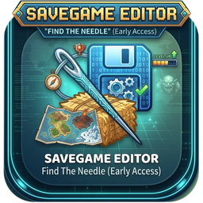
</p>

<h1 align="center">Find The Needle – Savegame Editor</h1>

<p align="center">
  Save editor for <b>Find The Needle</b> – Early Access (Steam, Godot 4).<br>
  One exe, dark UI, automatic backups – and a <b>haystack radar</b> that shows you where every needle is hidden.
</p>

<p align="center">
  <a href="../../releases/latest"></a>
  <a href="../../releases"></a>
  
  <a href="LICENSE"></a>
</p>

<p align="center">
  <a href="../../releases/latest"><b>⬇ Download FindTheNeedleEditor.exe</b></a>
</p>

<p align="center">
  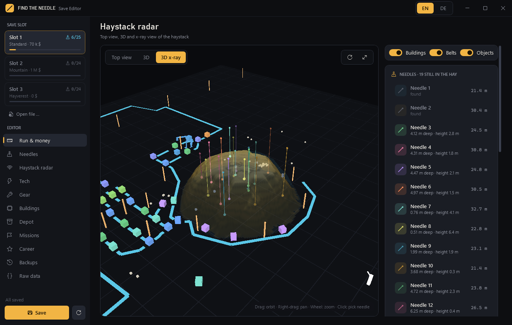
</p>

Unofficial fan tool, not affiliated with the developers of Find The Needle. The interface is in **English and German** – switch with **EN / DE** in the title bar.

## 🏁 Fair play: edited saves stay off the leaderboards

Find The Needle has online leaderboards. **Anything edited with this tool does not count for them – on purpose.**

- Every time the editor saves a slot, it sets `debug_used = true`, the same mark the game itself uses when its debug menu was used. A new game without edits counts again.
- The career records in `profile.cfg` feed the leaderboards, so the **Career** tab is read-only.
- The `board_*` fields, `debug_used` and `run_timed` are locked in the raw data view.

This cannot be switched off, and the editor never talks to any server. If you care about your leaderboard spot, **do not save with this editor**. Just looking around (radar, needles, stats) without saving changes nothing.

## 📡 Haystack radar

The pile hides 24 needles under metres of hay. The save stores the full height map of the pile and the exact position of every needle – the radar draws both.

| Top view | 3D view | 3D x-ray |
|----------|---------|----------|
| 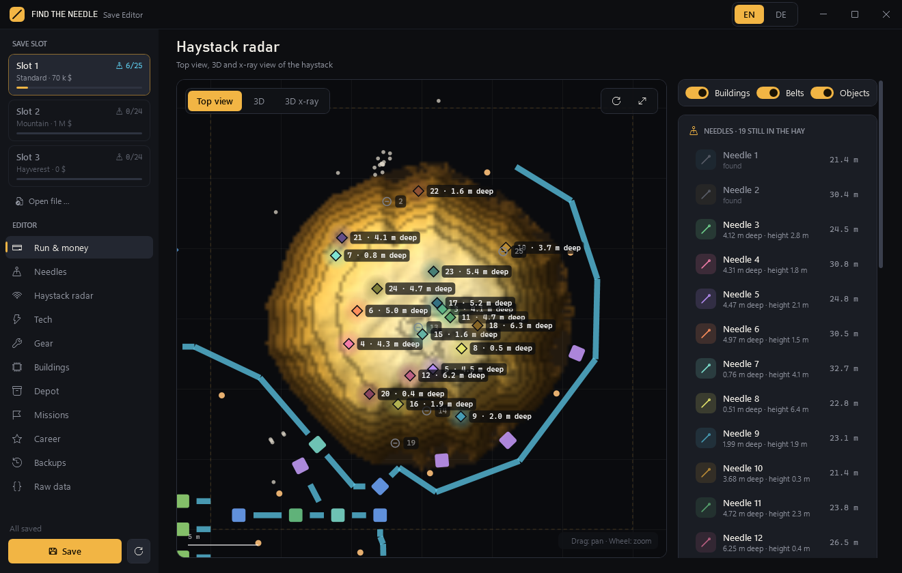 | 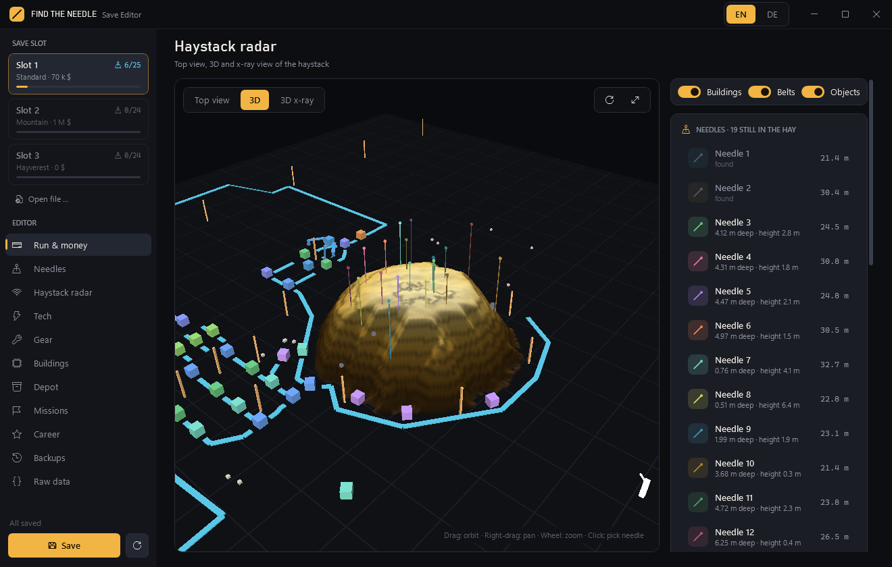 |  |

- **Top view**: hay height as a heat map with needles, buildings, belts, objects and the player. Drag to pan, wheel to zoom.
- **3D view**: the pile as terrain with everything built around it. Drag to orbit, right-drag to pan, wheel to zoom. The camera fits itself to the pile, even to the tall ones.
- **3D x-ray**: makes the hay see-through. A coloured line rises from every needle, so you see at a glance how deep it is buried.
- **Needle list** with depth, height and distance to the player. Pick a needle to **dig it out** (a funnel down to the needle), **put the player on top of it**, or mark it as found.
- **Pile tools**: scale the pile height, restore the original shape, or remove all hay.

## Features

| Tab | What you can change |
|-----|---------------------|
| **Run & money** | Balance with quick buttons (+1,000 … +1 M, ×2, ×10), debt, all run records as tiles (click to edit), times, jetpack fuel, radar cooldown, lot tier, haystack counters, slot name |
| **Needles** | Every needle in the pile: type, position, hay above it, found or not (counted like in the game: collection, stock and counters follow). Find all / put all back |
| **Haystack radar** | See above |
| **Tech** | All 160+ cards in 10 branches. Branch list with progress on the left, compact rows on the right: unlock switches for one-step cards, rank bar with −/+/MAX for the others. Filter all / open / done, search, +1 / −1 / MAX per branch, everything to MAX, reset |
| **Gear** | Shop tools (give / take), the build hotbar (keys 1–9), gifts waiting to be claimed, "new" badges |
| **Buildings** | Overview (count, switched on, invested, fuel), one card per building type with on/off switches, fuel and storage; switch all on/off, clear jammed belts |
| **Depot** | The shared depot stock: every good with amount, −10 / +10 / +100, fill all up to any amount, +100 for everything in stock, empty the depot. Grouped into hay goods, metal, parts, carbon & composite, bio. Depots on the yard (on/off) and the acceptance rules (limits and refused goods) with one click to lift them |
| **Missions** | Current mission (id, position, progress), orders, rewards already received, spending analysis from the purchase log |
| **Career** | Records across all runs from `profile.cfg`, records per pile size, play diary (read-only) |
| **Backups** | Automatic backup before every save, manual backup, restore any backup |
| **Raw data** | The complete save as a tree; every simple value can be edited |

| Run & money | Needles | Tech |
|-------------|---------|------|
| 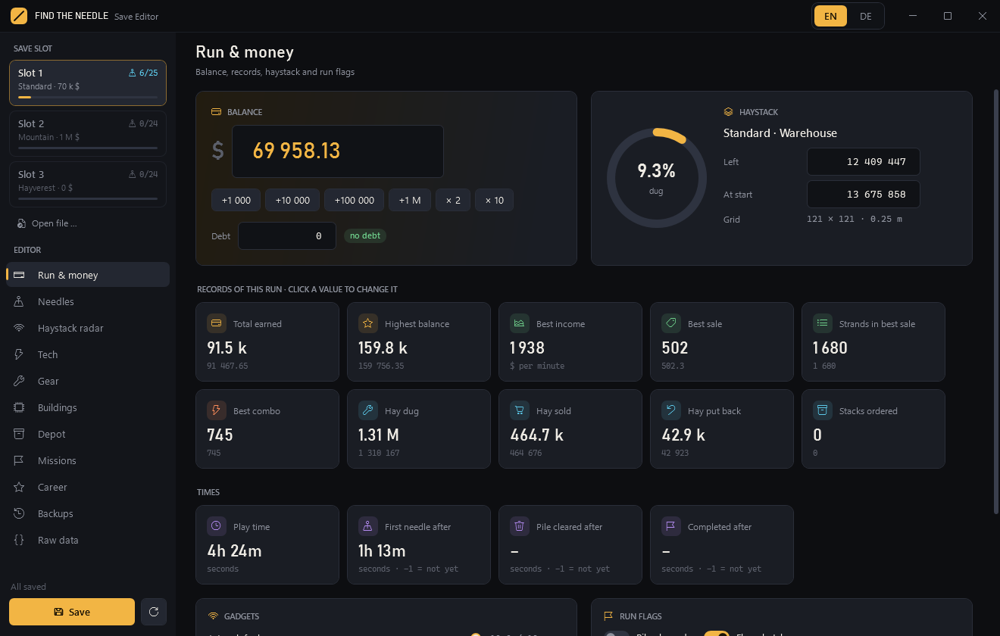 | 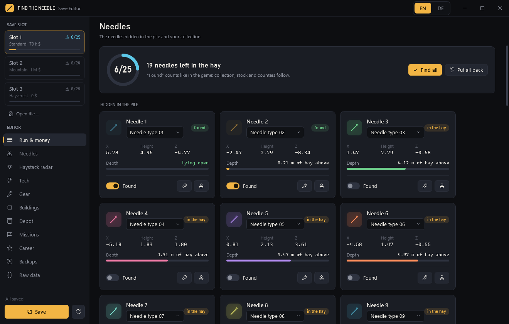 | 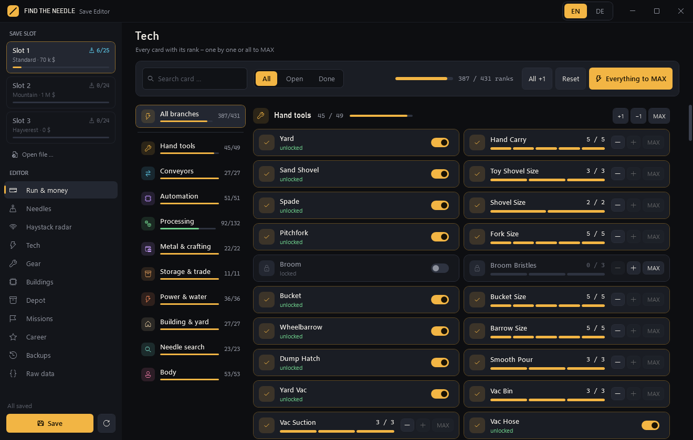 |

| Gear | Buildings | Depot |
|------|-----------|-------|
| 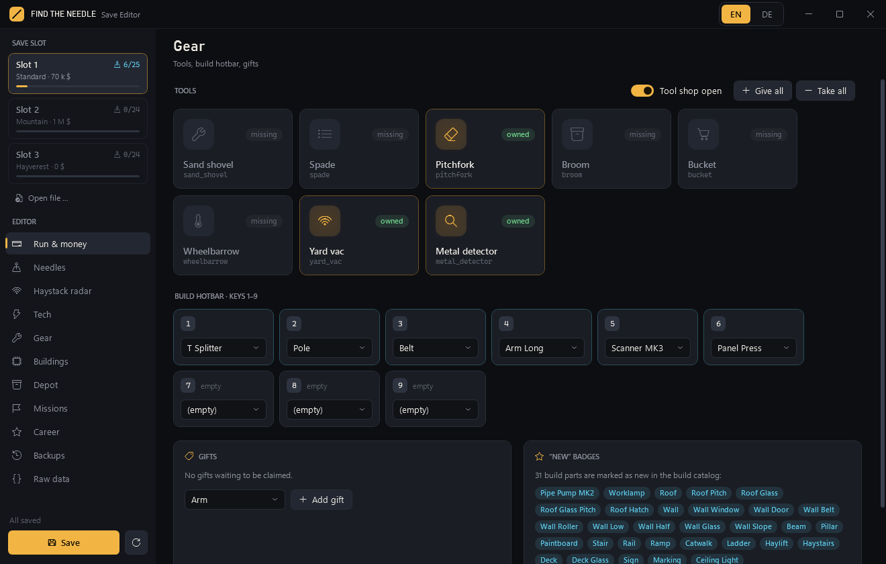 | 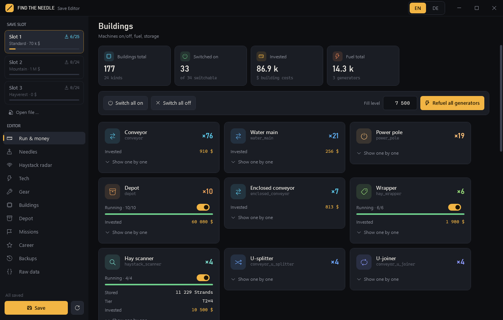 | 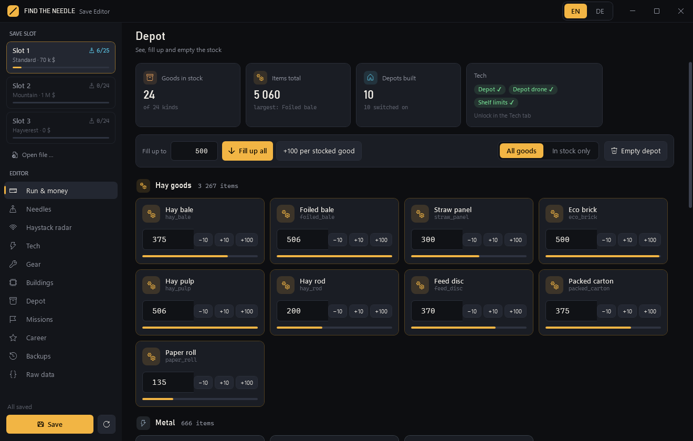 |

| Missions |
|----------|
| 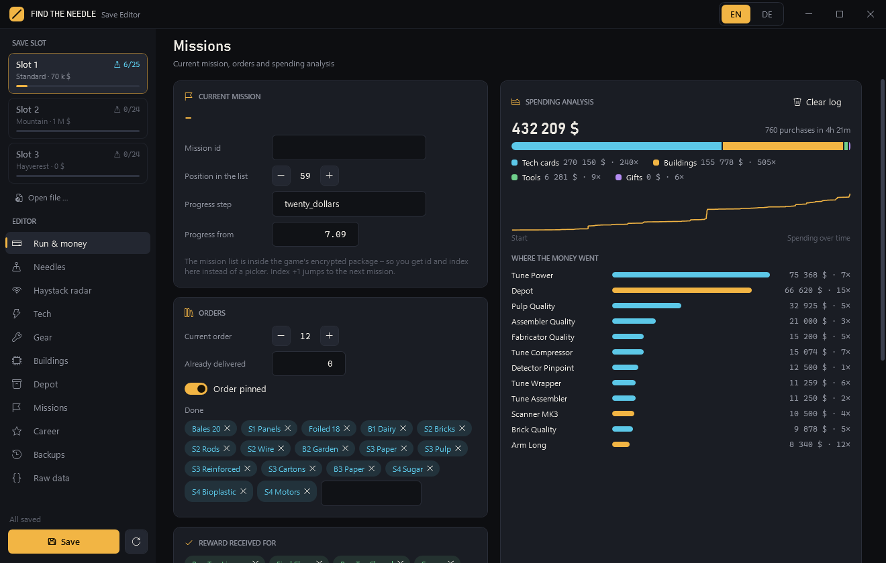 |

Also:

- 🏁 Saving marks the run as not ranked (see [Fair play](#-fair-play-edited-saves-stay-off-the-leaderboards))
- Reads and writes Godot's binary Variant format itself; values the editor does not know are kept as they are
- English and German interface, switch with **EN / DE** in the title bar; the choice is kept in `%APPDATA%\FindTheNeedleEditor\settings.ini`
- Finds the save folder on its own; any other save file can be opened with **Open file …**
- Single self-contained exe, no installation, no .NET runtime needed

Known limits: the game's data tables are inside its encrypted package, so needle types and missions are shown by number or id instead of by name.

## Usage

1. Download `FindTheNeedleEditor.exe` from the [latest release](../../releases/latest) (Windows 10/11 x64).
2. Close the game (its autosave would overwrite your changes).
3. Start the editor, pick a slot, change what you want, click **Save** (Ctrl+S).

The editor looks for saves here, in this order:

```
Early Access   %APPDATA%\Godot\app_userdata\FindTheNeedle\saves\slot_0.dat
Demo           %APPDATA%\Godot\app_userdata\Haystack Incremental\saves\slot_0.dat
```

The first folder that contains slots is used. `profile.cfg` sits next to `saves`, backups go to `NeedleEditorBackups` in the same folder.

## Save format

```
"GDEC" | MD5(plain) 16 B | uint64 plain length | IV 16 B | AES-256-CFB(plain, zero padded)
key   = md5_text("b88b32d1fb83a23ac1facd11a612222774cca9aed41a87ed") as 32 ASCII chars
plain = Godot store_var: uint32 length + binary-serialized Variant (a Dictionary)
```

This is Godot's `FileAccess.open_encrypted_with_pass`. The password is a constant of the game, so it is the same for every player. The dictionary holds `state` (money, needles, missions, …), `heights` / `dome` (height maps of the pile, 0.25 m cells), `player`, `buildings`, `props`, `belts`, `tech` (`ranks`, `shop_tools`) and `meta` (main-menu preview).

## Build

Needs the .NET 10 SDK.

```
build.cmd
```

It builds and publishes the single-file exe next to the script. Developer aids:

- `FindTheNeedleEditor.exe --shots <folder> [--lang en|de]` renders every tab plus the radar views to PNG and exits
- `FindTheNeedleEditor.exe --dump <save> <out.txt>` writes the decrypted save as a text tree

## Layout

| Path | Purpose |
|------|---------|
| `src/GdVariant.cs` | Godot 4 Variant binary format (decode/encode) |
| `src/SaveFile.cs` | GDEC encryption, save folder detection, typed access to the save, backups, needle and pile operations |
| `src/PileViews.cs`, `src/RadarPage.cs` | Radar top view, 3D view and tools |
| `src/Pages.cs`, `src/Pages2.cs`, `src/Pages3.cs` | The other tabs (`Pages3.cs`: Tech and Depot) |
| `src/GameData.cs` | Tech branches, depot goods, building names – collected from real saves |
| `src/Loc.cs`, `src/LocEn.cs` | Language switch; German texts are the keys, English comes from the table |
| `src/Ui.cs`, `src/App.xaml` | Controls, theme, styles |
| `src/MainWindow.cs` | Window, sidebar, saving |

See [CHANGELOG.md](CHANGELOG.md) for the version history.

## License

MIT, see [LICENSE](LICENSE).
